# Diagramas UML — Busca A* (Arad → Bucharest)

Artefatos de Engenharia de Software do projeto: os diagramas UML que descrevem os
arquivos, os dados e o fluxo de cada fase. Os diagramas estão em Mermaid e são
desenhados pelo próprio GitHub.

| Rótulo | Diagrama | Mostra |
|---|---|---|
| act | Atividade | o fluxo de execução: o que acontece em que ordem |
| sd | Sequência | quem chama quem, de cima para baixo no tempo |
| class | Classes | a forma dos dados |
| object | Objetos | os dados num instante, com valores reais |
| stm | Estados | os estados por que algo passa |
| pkg | Pacotes | como os arquivos se organizam |

## Sumário

- [Visão geral do projeto](#visão-geral-do-projeto) — diagramas 1 e 2
- [Fase 0 — Ambiente, Git e GitHub](#fase-0--ambiente-git-e-github) — diagramas 3 e 4
- [Fase 1 — Navegar nos dados](#fase-1--navegar-nos-dados) — diagramas 5, 6 e 7
- [Fase 2 — Custo de caminho e f = g + h](#fase-2--custo-de-caminho-e-f--g--h) — diagrama 8
- [Fase 3 — O nó e a fronteira](#fase-3--o-nó-e-a-fronteira) — diagramas 9, 10 e 11
- [Fase 4 — Expandir vira função](#fase-4--expandir-vira-função) — diagramas 12 e 13
- [Fase 5 — O laço da busca A*](#fase-5--o-laço-da-busca-a) — diagrama 14
- [Fase 6 — O programa completo](#fase-6--o-programa-completo) — diagramas 15 e 16

---

## Visão geral do projeto

### Diagrama 1 — Roteiro do projeto (act)

Cada fase termina com um commit e um push.

```mermaid
flowchart LR
    inicio(( )) --> F0
    F0["Fase 0<br/>ambiente + GitHub"] -->|commit + push| F1
    F1["Fase 1<br/>navegar nos dados"] -->|commit + push| F2
    F2["Fase 2<br/>caminhos e g, h, f"] -->|commit + push| F3
    F3["Fase 3<br/>nó e fronteira"] -->|commit + push| F4
    F4["Fase 4<br/>expandir um nó"] -->|commit + push| F5
    F5["Fase 5<br/>laço while (A*)"] -->|commit + push| F6
    F6["Fase 6<br/>programa completo"] -->|commit + push| TAG
    TAG["tag v1.0"] --> fim((( )))
```

### Diagrama 2 — Arquivos do projeto e suas dependências (pkg)

A seta tracejada «import» quer dizer "usa os dados de". Cada fase é um arquivo novo que faz
`from mapa import mapa_romenia, heuristica_bucareste`.

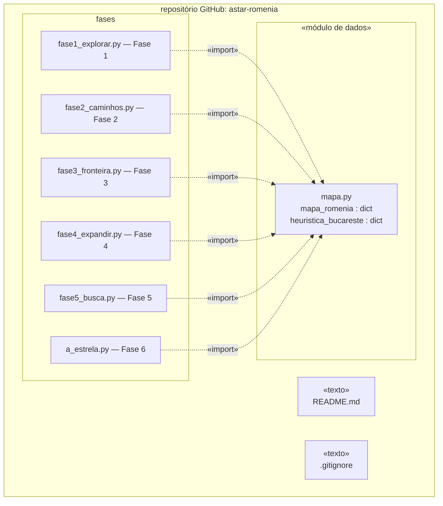

---

## Fase 0 — Ambiente, Git e GitHub

### Diagrama 3 — O que se faz no navegador e no computador (act, com raias)

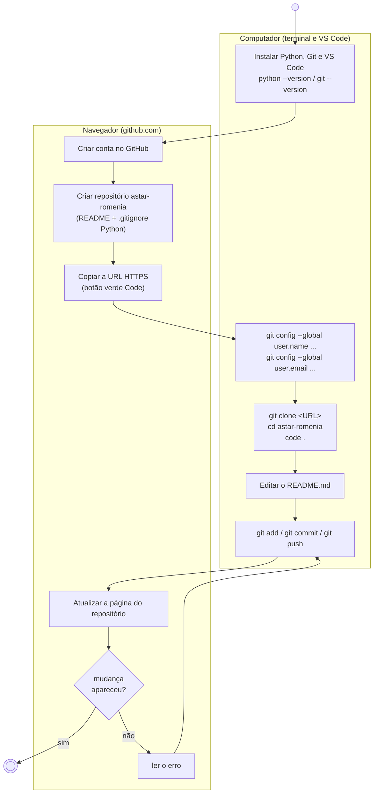

### Diagrama 4 — Por quais estados um arquivo passa no Git (stm)

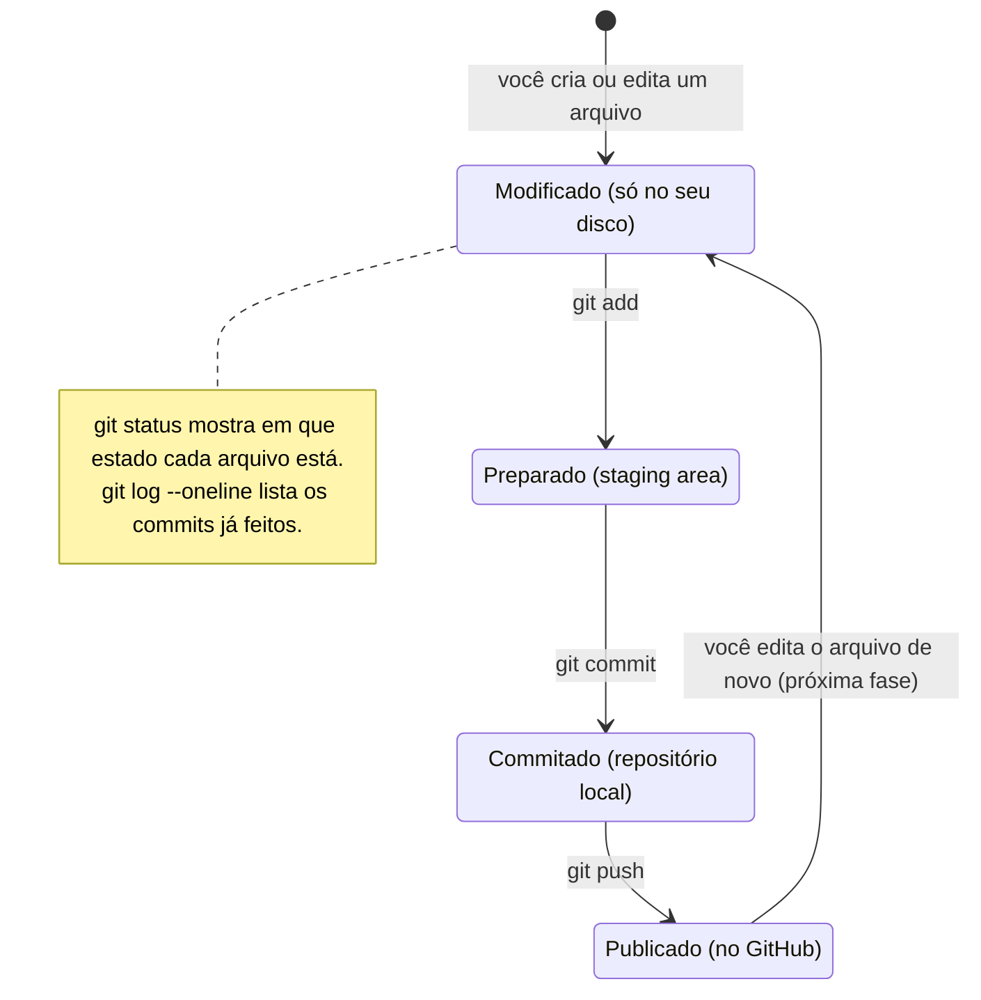

---

## Fase 1 — Navegar nos dados

### Diagrama 5 — Estrutura de dados do mapa (class)

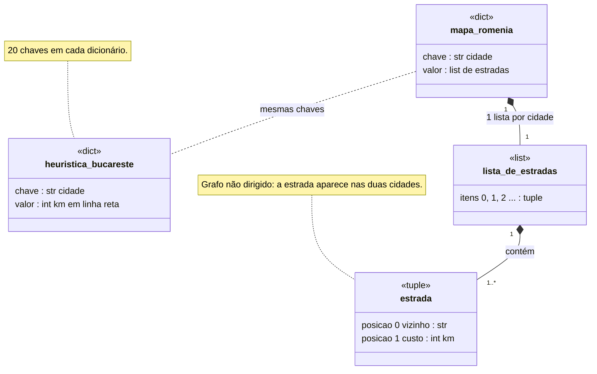

### Diagrama 6 — `mapa_romenia['Arad']` na memória (object)

Os números entre colchetes são os índices.

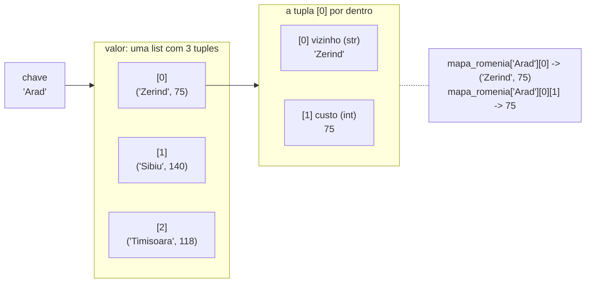

### Diagrama 7 — Fluxo do script `fase1_explorar.py` (act)

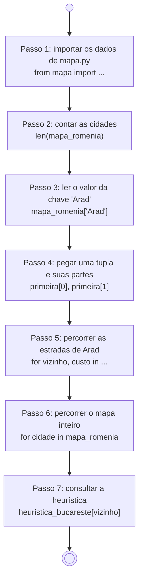

---

## Fase 2 — Custo de caminho e f = g + h

### Diagrama 8 — Chamadas para calcular o custo de um caminho (sd)

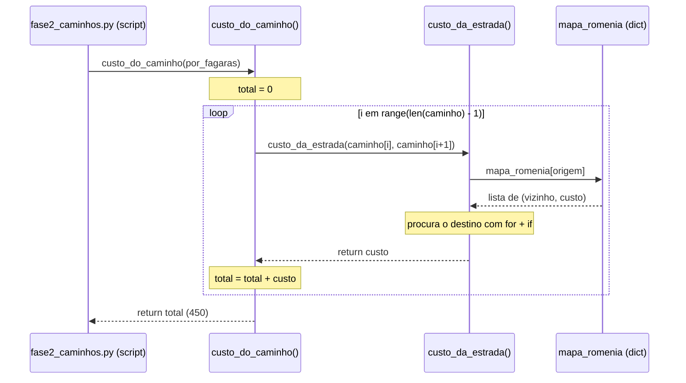

---

## Fase 3 — O nó e a fronteira

### Diagrama 9 — O nó de busca e a fronteira (class)

A fronteira é uma lista de nós. Exemplo de nó: `(393, 140, 'Sibiu', ['Arad', 'Sibiu'])`.

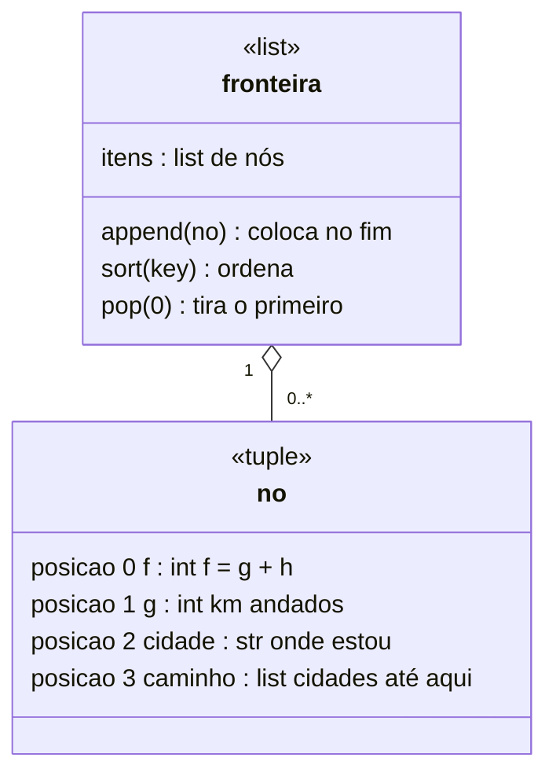

### Diagrama 10 — Primeira expansão, feita à mão (sd)

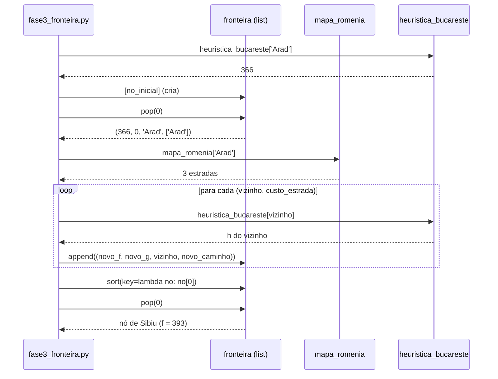

### Diagrama 11 — Três fotografias da fronteira (object)

O nó em destaque é o de menor f.

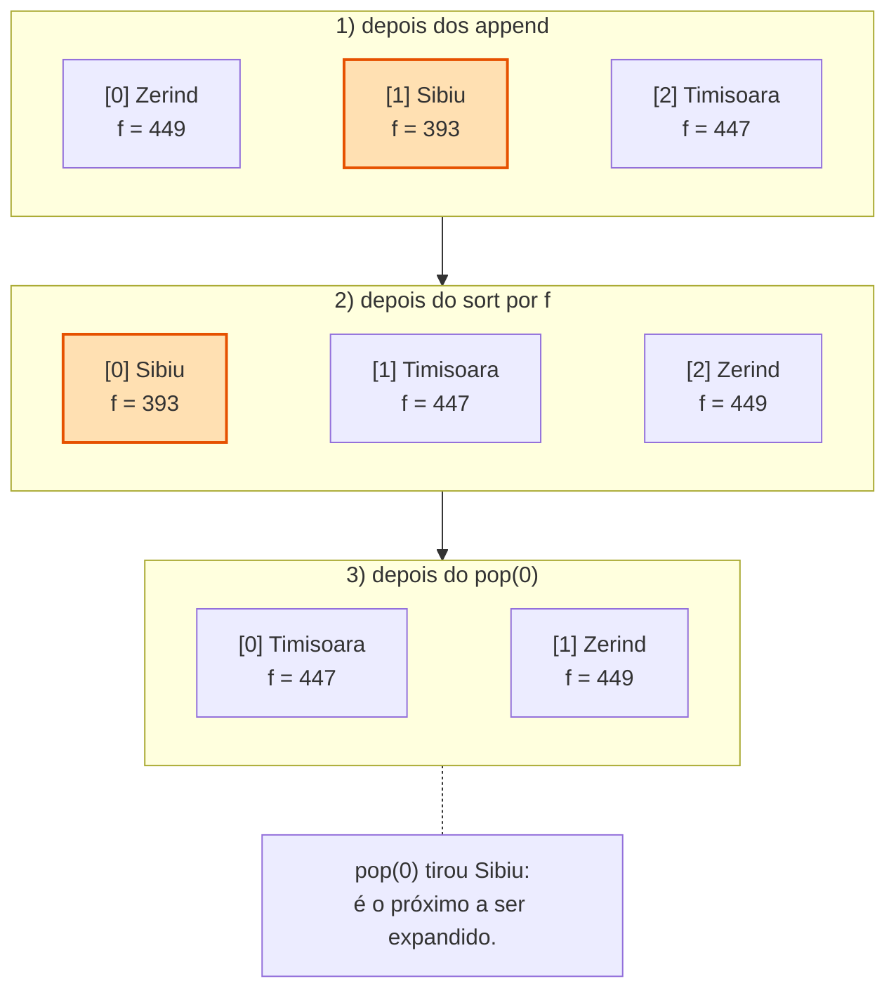

---

## Fase 4 — Expandir vira função

### Diagrama 12 — A função `expandir(no, explorados)` (act)

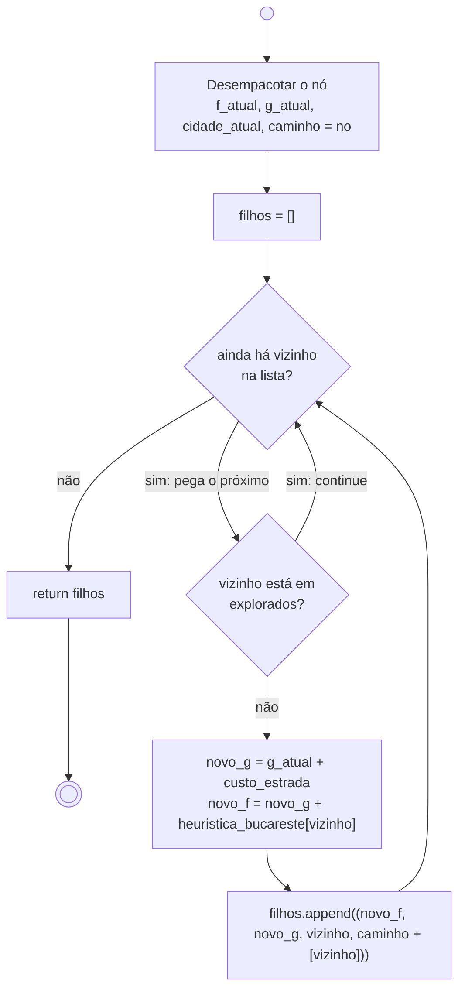

### Diagrama 13 — Uma rodada da busca, repetida 3 vezes (sd)

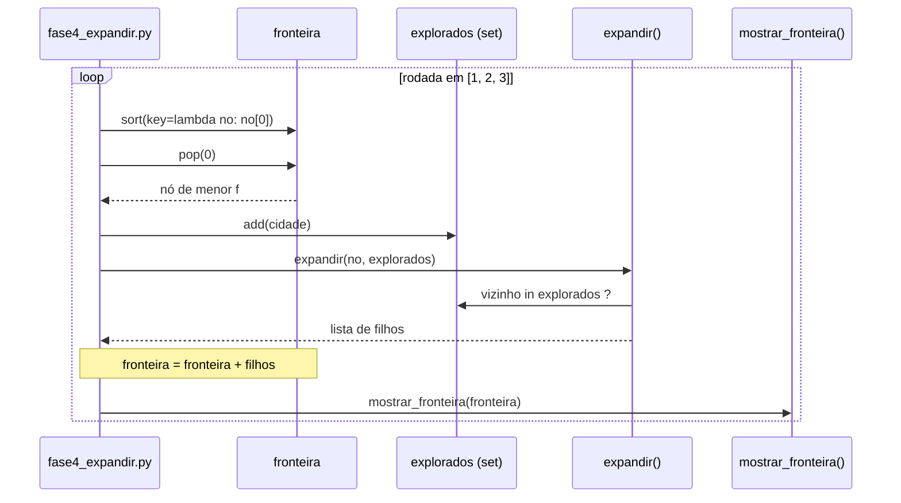

---

## Fase 5 — O laço da busca A*

### Diagrama 14 — O algoritmo A* `busca_a_estrela(inicio, objetivo)` (act)

O teste de objetivo é feito ao **retirar** o nó da fronteira, não ao gerá-lo. É isso que
garante o caminho ótimo.

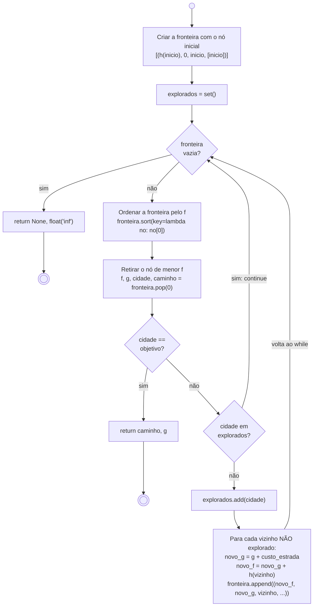

---

## Fase 6 — O programa completo

### Diagrama 15 — O programa completo `a_estrela.py` (sd)

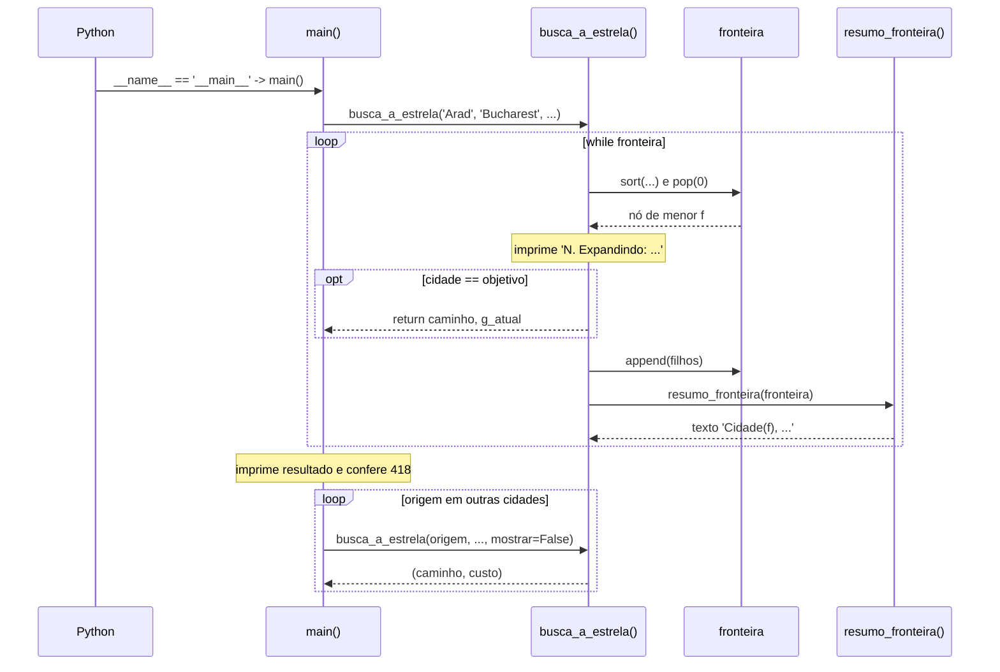

### Diagrama 16 — Árvore de busca gerada pelo A* (object)

O número antes do nome é a ordem em que o nó saiu da fronteira. Bucharest (450) foi gerado
mas nunca retirado, porque 418 < 450. Em verde, o caminho ótimo.

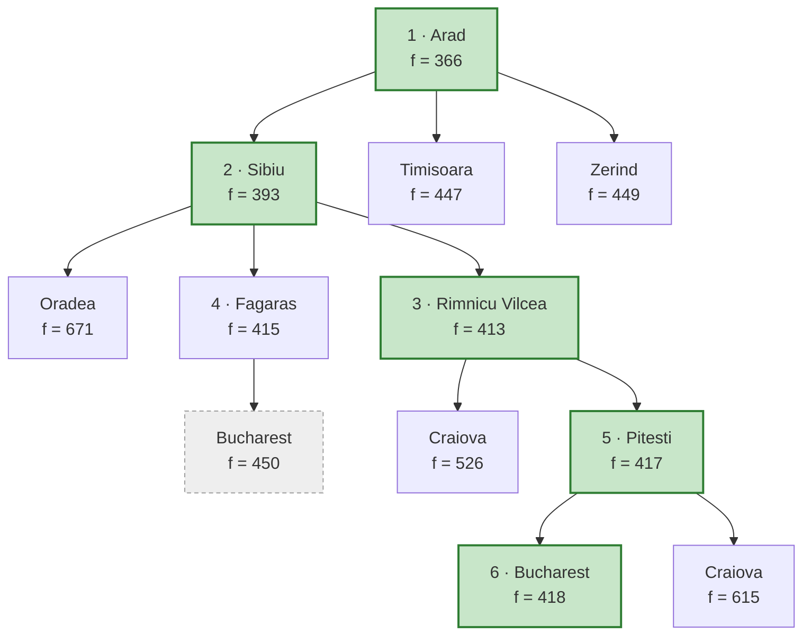

Rastro completo, iteração por iteração (saída real de `python a_estrela.py`):

| # | Expande | g | h | f | Fronteira depois (ordenada por f) |
|---|---|---|---|---|---|
| 1 | Arad | 0 | 366 | 366 | Sibiu(393), Timisoara(447), Zerind(449) |
| 2 | Sibiu | 140 | 253 | 393 | Rimnicu Vilcea(413), Fagaras(415), Timisoara(447), Zerind(449), Oradea(671) |
| 3 | Rimnicu Vilcea | 220 | 193 | 413 | Fagaras(415), Pitesti(417), Timisoara(447), Zerind(449), Craiova(526), Oradea(671) |
| 4 | Fagaras | 239 | 176 | 415 | Pitesti(417), Timisoara(447), Zerind(449), Bucharest(450), Craiova(526), Oradea(671) |
| 5 | Pitesti | 317 | 100 | 417 | Bucharest(418), Timisoara(447), Zerind(449), Bucharest(450), Craiova(526), Craiova(615), Oradea(671) |
| 6 | Bucharest | 418 | 0 | 418 | (objetivo: fim da busca) |

---

Referência: RUSSELL, S.; NORVIG, P. *Inteligência Artificial*. 3. ed. Rio de Janeiro: Elsevier, 2013. Capítulo 3.
